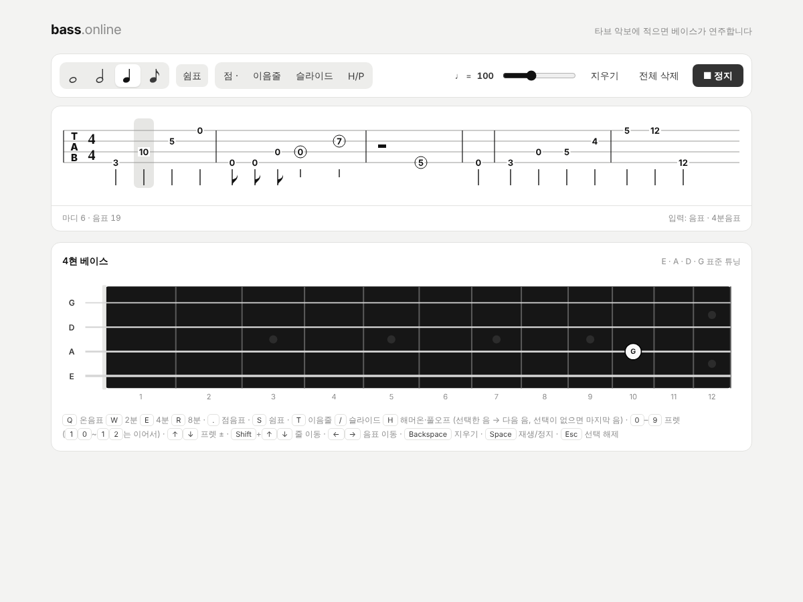
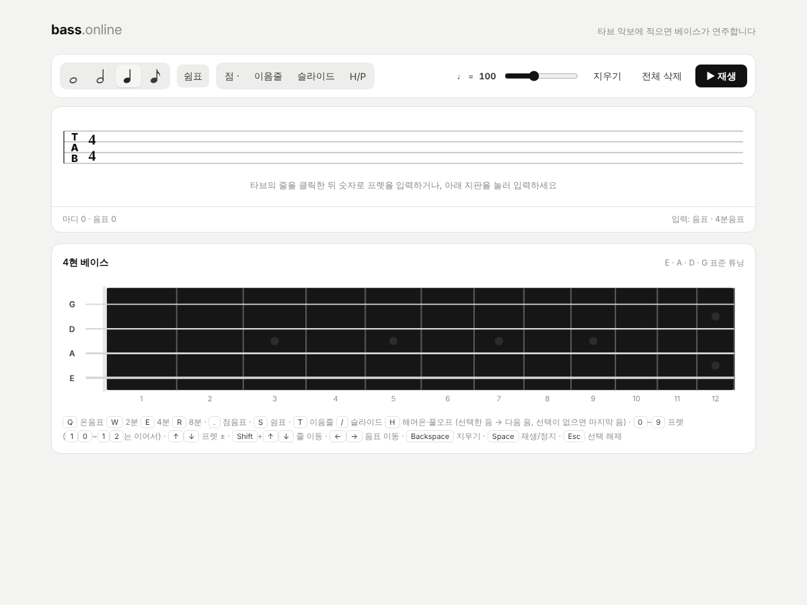
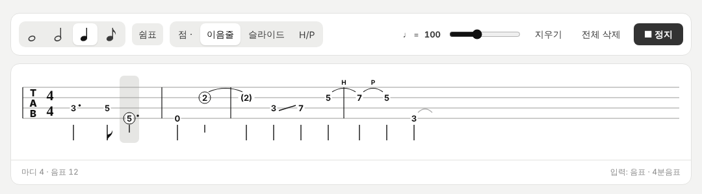
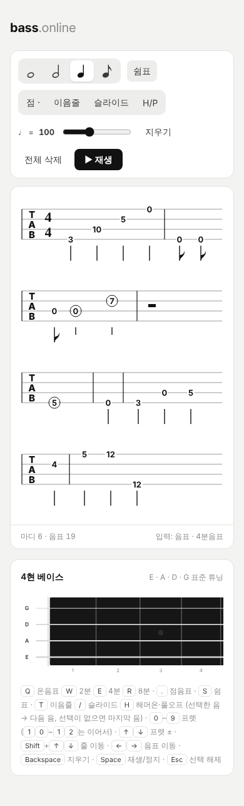

# bass-online

브라우저에서 타브(TAB) 악보에 적으면 베이스가 연주하는 간단한 웹 페이지입니다.

- `index.html` 하나로 동작합니다. 브라우저로 열기만 하면 됩니다(설치·서버 불필요).
- 타브의 줄을 클릭한 뒤 숫자 키로 프렛을 입력하거나, 아래 지판을 눌러 입력하고, 재생 버튼으로 들어볼 수 있습니다.
- 점음표, 이음줄, 슬라이드, 해머온·풀오프(H/P)를 표시하고 소리에도 반영합니다.
- 소리는 Web Audio API로 합성합니다. 입력한 내용은 저장되지 않으며 페이지를 닫으면 사라집니다.

## 스크린샷

### 시작 화면

### 연주 기호

점음표, 이음줄, 슬라이드, 해머온·풀오프를 타브에 표시합니다.

### 모바일

